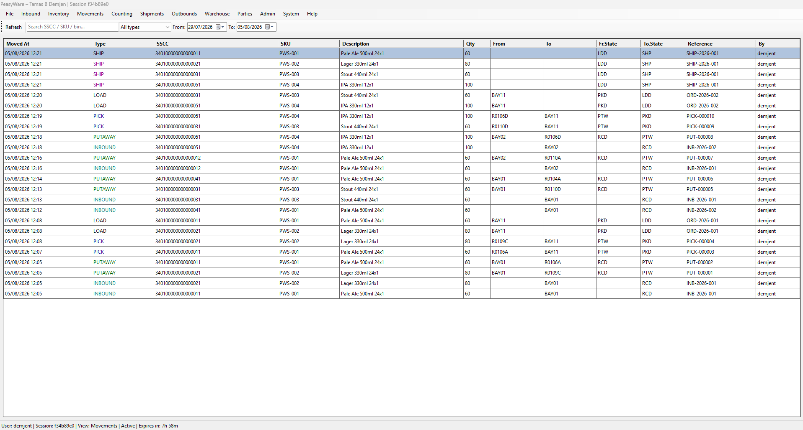
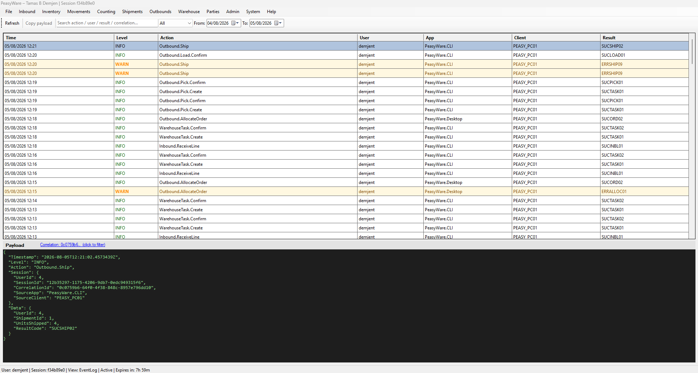

# PeasyWare-Core


**PeasyWare** is a professional-grade **Warehouse Management System (WMS)** built in C#/.NET 10 with SQL Server, modelling real warehouse operations end to end.

Built with reference to enterprise platforms such as **SAP EWM**, **Manhattan WMS**, and **Blue Yonder** — from the ground up, with production-quality design principles. Designed for single-site and 3PL environments.

---

## See it in action

<table>
<tr>
<td width="50%">
<a href="docs/screenshots/readme/movements_log.png"></a>
<br><sub>One pallet's full lifecycle — <code>RCD → PTW → PKD → LDD → SHP</code> — in a single view, with reference codes and clean order/shipment naming throughout.</sub>
</td>
<td width="50%">
<a href="docs/screenshots/readme/events_log.png"></a>
<br><sub>The structured event log — a mandatory-load-before-ship guard (<code>ERRSHIP09</code>) actually firing and recovering, not a cherry-picked clean run, with full correlation-ID payload detail below.</sub>
</td>
</tr>
</table>

More screenshots: [`docs/screenshots/`](docs/screenshots/)

---

## Tech stack

- C# / .NET 10
- SQL Server — write operations and business logic in stored procedures; read operations via views
- No ORM — raw ADO.NET with named parameter mapping
- Event-stream audit trail (`audit.trace_logs`) with structured JSON payload
- Desktop + CLI: Windows. CLI only: macOS, Linux

---

## Architecture

```
CLI (RF-style terminal)        Desktop Application
         │                             │
         └──────────────┬──────────────┘
                        ▼
            Application Layer
          Flows / Services / DTOs
                        │
                        ▼
           Infrastructure Layer
         SQL Repositories / Bootstrap
                        │
                        ▼
              SQL Server Database
         Schemas: inventory, inbound,
         outbound, warehouse, locations,
         operations, auth, audit, core
```

**Design principles:**
- Every process has a Reversal Path
- Every operation carries a Correlation ID
- RBAC is enforced inside the stored procedure (`auth.fn_has_permission`, checked first, inside the transaction) for configuration and elevated actions; floor operations (receive, putaway, pick, load, ship, move, count) are open to any authenticated user by design
- All SPs use `SET XACT_ABORT ON` + `BEGIN CATCH`
- Error codes follow `ERRAUTH01` pattern (prefix ERR/WAR/SUC, no hyphens)
- `UPDLOCK, HOLDLOCK` on concurrent reads
- C# session identity (`UserId`, `SessionId`) is bound into SQL Server's `SESSION_CONTEXT` once per connection via `SqlConnectionFactory.CreateForCommand` — the mechanism `auth.fn_has_permission` and several SPs (settings, user management) rely on; most SPs take `@user_id`/`@session_id` as explicit parameters instead
- Bin codes are canonical uppercase and matched exactly (`COLLATE Latin1_General_CS_AS`) — a wrong-case entry is refused, never silently corrected (`IdentifierPolicy`)

---

## Warehouse Lifecycle

```
Supplier ASN / Manual Receive
         │
         ▼
Inbound Receiving (SSCC or Manual mode)
│  Cross-receive locked — each inbound
│  only accepts its own SSCCs
         │
         ▼
Inventory Unit Created (RCD state)
         │
         ▼
Putaway Task → Operator confirms → PTW state
│  Bin-to-bin move out of staging = manual
│  putaway, transitions RCD → PTW automatically
         │
         ▼
Bin-to-Bin Movement (optional, any operator)
         │
         ▼
Outbound Order → Allocation Engine (FEFO / FIFO / LIFO / NONE)
│  Full or partial allocation — operator prompted
│  when stock is insufficient for full order
         │
         ▼
Pick Task → Operator scans bin + SSCC → PKD state
         │
         ▼
Load Confirmation → LDD state
│  Placement removed here, not at ship — the unit
│  physically leaves the warehouse floor the moment
│  it's loaded, freeing the loading bay's capacity
│  while the vehicle is still on-site awaiting
│  departure. Mandatory before ship.
         │
         ▼
Ship Confirmation → SHP state
│  Delivery note auto-printed if configured
         │
         ▼
Full lifecycle audit trail complete
```

Alongside the lifecycle, a **stock count** audits the warehouse floor: the system lists the bins it believes are empty, an operator walks them, and anything found where it shouldn't be is corrected under the same rules a bin-to-bin move uses — or flagged for a manager's review. See [Stock counting](#stock-counting).

---

## Quick Start

### 1 — Prerequisites

- [.NET 10 SDK](https://dotnet.microsoft.com/download/dotnet/10.0)
- SQL Server — Developer edition, or any edition with SQL Server Agent. The build creates two Agent jobs (session cleanup, daily expiry sweep); Express has no Agent, so the jobs cannot run there
- `sqlcmd` on PATH — install via [SQL Server command-line tools](https://learn.microsoft.com/en-us/sql/tools/sqlcmd/sqlcmd-utility)

### 2 — Clone

```bash
git clone https://github.com/demtamas/PeasyWare-Core.git
cd PeasyWare-Core
```

### 3 — Set environment variables

These must be set **before** building or running anything.

#### `PEASYWARE_DB` — SQL Server connection string (required)

**Windows (PowerShell — session):**
```powershell
$env:PEASYWARE_DB = "Server=localhost;Database=Pw_Core_DEV;User Id=sa;Password=yourpassword;TrustServerCertificate=True;"
```

**Windows (permanent — survives reboots):**
```powershell
[System.Environment]::SetEnvironmentVariable(
    "PEASYWARE_DB",
    "Server=localhost;Database=Pw_Core_DEV;User Id=sa;Password=yourpassword;TrustServerCertificate=True;",
    "Machine"
)
```

**macOS / Linux:**
```bash
export PEASYWARE_DB="Server=localhost;Database=Pw_Core_DEV;User Id=sa;Password=yourpassword;TrustServerCertificate=True;"
```

> `TrustServerCertificate=True` is required for local SQL Server instances with self-signed certificates (default on most dev setups). `pwtools reset-db` reads this from the connection string and passes `-C` to sqlcmd automatically.

> For Windows Authentication, replace `User Id=sa;Password=...` with `Trusted_Connection=True`.

#### `PEASYWARE_API_KEY` — API key (required for seeding only)

The REST API requires a shared secret passed as `X-Api-Key`. Choose any string — it just needs to match on both the API server and the seed script caller.

```powershell
$env:PEASYWARE_API_KEY = "peasyware-dev-key"
```

Set this on any machine that will run the API **or** the seed scripts. Both sides must have the same value.

### 4 — Build

```powershell
dotnet build
```

### 5 — Database

Reset (or create fresh) the database schema:

```powershell
tools\PeasyWare.Tools\bin\Debug\net10.0\pwtools.exe reset-db --confirm
```

This runs every script in `Database/Scripts/` in folder order against the database defined in `PEASYWARE_DB`. On a fresh install it creates the database from scratch. On an existing install it backs up and drops first. Add `--no-demo` for a bare install without the demo parties and warehouse layout.

### 6 — Test data (optional)

Seed SKUs, inbounds, outbound orders, and shipments via the REST API:

```powershell
# Terminal 1 — start the API
dotnet run --project src/PeasyWare.API

# Terminal 2 — run seeds
cd Database/Seeds
.\run_seeds.ps1              # all test data
.\run_seeds.ps1 -Only 1      # SKUs only
.\run_seeds.ps1 -Only 2      # Inbounds only
.\run_seeds.ps1 -Only 1,2    # SKUs + Inbounds
```

> `PEASYWARE_API_KEY` must be set and the API must be running before seeds will work.

### 7 — Run

```powershell
# RF-style terminal (CLI) — Windows, macOS, Linux
dotnet run --project src/PeasyWare.CLI

# Desktop application — Windows only
dotnet run --project src/PeasyWare.Desktop
```

Initial credentials: `admin` / `admin0` — password change required on first login (min 8 chars, uppercase + lowercase + number).

### 8 — Tests

```bash
dotnet test --filter "Category!=Concurrency"
```

This is the fast run — the unit tests, no live locking scenarios.

The SQL test suite (`Database/Tests/*.sql`) runs separately against `PEASYWARE_DB` and needs `sqlcmd` on PATH and a built database:

```powershell
.\run_db_tests.ps1                    # everything
.\run_db_tests.ps1 -Filter "count"    # a subset, matched on file name
```

The concurrency proof harness (`tests/PeasyWare.ConcurrencyTests`) is excluded from
the command above on purpose: it opens real concurrent connections against
`PEASYWARE_DB` and hammers the same rows to prove locking invariants hold
(e.g. two orders can never both be allocated the last unit of stock), which
is slower and needs a live, seeded database rather than being a fast
sanity check. Run it explicitly:

```bash
dotnet test tests/PeasyWare.ConcurrencyTests
```

---

## Features

### Inbound
- Create delivery advice (ASN) from Desktop — header, lines, expected SSCCs
- Cancel inbound — blocked if any receipts exist
- SSCC mode receive with GS1-128 barcode parser (parenthesis, raw FNC1, tilde formats)
- Manual mode receive — two-label scan (product + pallet)
- Claim token pattern — prevents concurrent SSCC receives
- Cross-receive lock — receiving session bound to its own inbound
- Receipt reversal with full audit chain
- `is_batch_required` and `standard_hu_quantity` enforced per SKU
- Desktop view — status, progress, line drill-down, SSCC-level detail with received by / at

### Inventory
- State machine (`RCD → PTW → MOV/PKD → LDD → SHP/REV`)
- Bin placements — rack (capacity 1) and bulk (capacity-based)
- SSCC enquiry — UiMode-tiered display (Minimal / Standard / Trace)
- Bin enquiry — single unit detail or multi-unit summary with drill-down
- Stock owner per SKU — single-owner or multi-owner (3PL) via `inventory.enable_multi_owner`
- Manual bin-to-bin move out of staging automatically transitions `RCD → PTW`
- Desktop view — owner, state, status, allocation reference, search

### Warehouse Tasks
- Putaway — zone load balancing, bin reservation, TTL expiry
- Bin-to-bin movement — any operator. One shared definition of "free to be moved" (state, stock status, no open task) and of "bin can receive" (active, unlocked, capacity including reservations); the destination is held for the task and re-validated under lock at confirm; abandoned move tasks expire and are replaced
- Pick tasks — allocation-driven, operator-specified staging bay
- Supervisor Desktop view — cancel orphaned tasks, filter by type, creator and completer columns

### Outbound
- Create orders from Desktop — customer, haulier, required date, lines (SKU / qty / batch / BBE)
- Cancel orders — NEW status only
- Allocation engine — FEFO / FIFO / LIFO / NONE (settings-driven)
- Partial allocation with operator prompt
- Re-allocation and top-up allocation during active picking
- Pick flow — bin scan validated before SSCC prompt
- Order-level load confirmation tied to its shipment (`usp_confirm_load`) — transitions picked units to `LDD` and removes their placement at load time, not ship time; no per-SSCC re-scan after picking
- Load confirmation is mandatory before ship — a shipment with any picked-but-not-yet-loaded order is rejected (`ERRSHIP09`)
- Ship confirmation — transitions all units to SHP, closes shipment
- Delivery addresses per order — supports multi-depot customers
- Create shipments from Desktop — haulier, vehicle, planned departure, add orders
- Cancel shipments — OPEN / LOADING only, blocked if orders in progress
- Delivery note — generated on ship, opens in browser or prints silently to named printer

### Shelf life
- Minimum remaining shelf life per SKU, with customer + SKU overrides for the exceptions — the effective requirement is override → SKU default → 0, applied live rather than copied
- Allocation compares each candidate's best-before date with the order's delivery date plus the required days
- The allocation trace records the delivery date, each unit's best-before date and the required days on every outcome, so a decision can be reconstructed from the log alone
- Customer shelf-life screen in Desktop (Inventory menu), gated on `materials.manage`
- A daily expiry sweep (SQL Server Agent) flags stock past its best-before date as expired

### Stock counting
- **Empty-bin check (CLI, Counts menu)** — pick a storage type; the system lists the bins it believes are empty; scan each bin to confirm it. Counts are resumable and close themselves when the last bin is done
- A pallet found in an "empty" bin has its recorded location corrected under the same rules a bin-to-bin move uses, or is recorded for review. A count never creates or revives stock: shipped, reversed and unknown pallets are recorded and left alone
- A shipped pallet found in the building says which delivery, vehicle, order and customer it left on
- A count that found something it could not put right goes to **Needs review** — never "complete" — until a manager or admin marks it reviewed, with a note on what was done
- Desktop Counting view — counts needing attention by default (history one click away), findings with their reasons, reviewer and note shown
- Cycle counting (ABC frequency, blind counts, tolerances) is planned on the same tables

### Parties
- Suppliers, customers, hauliers, owners, warehouse — multi-role per party
- Create and edit from Desktop Parties view
- Filterable by role — All / Suppliers / Customers / Hauliers / Owners
- Owner party assignment per SKU for 3PL mode

### Materials (SKU Management)
- Create, edit, copy from Desktop
- Owner assignment, storage type, section, batch / full-HU flags
- Full audit trail — before/after change log

### Logs and Audit
- Event log view — full `audit.trace_logs` with level filter, date range, text search
- JSON payload preview panel — click any row to see full structured payload
- Correlation ID filter — click to show all events on the same operation
- Login attempts view — pre-filtered to auth events
- User changes view — unified timeline from trigger (`user_changes`) and trace log sources
- Movement log — full pallet lifecycle (INBOUND → PUTAWAY → PICK → SHIP) with reference resolution
- SKU audit — before/after change log per SKU

### Printing
- `printing.auto_print_delivery_note` — silent print on ship if enabled
- `printing.delivery_note_printer` — named printer
- `printing.delivery_note_copies` — 1–5 copies
- HTML delivery note template in `Database/Templates/delivery_note.html` — customisable without recompiling
- Template auto-located by walking up from binary; inline fallback if not found

### Infrastructure
- Role-based access control (RBAC) — verb-on-resource permissions (`auth.permissions` / `auth.role_permissions`), enforced in the stored procedure via `auth.fn_has_permission` for configuration and elevated actions, mirrored in Desktop and CLI UI gating. Floor operations are deliberately open to any authenticated user — see [`docs/architecture.md`](docs/architecture.md)
- Concurrency proof suite (`tests/PeasyWare.ConcurrencyTests`) — load-tests the highest-contention paths (allocation, putaway confirm, pick confirm) against a real database; found and fixed a destination-bin overfill race plus a related off-by-one
- Role-based UiMode (Minimal / Standard / Trace) — system ceiling enforced
- Session management — `SessionContext` (`SourceApp`, `SourceClient`, `CorrelationId`) carried through every operation, TTL, heartbeat, force login, concurrent session guard
- Structured audit log with JSON payload (`audit.trace_logs`)
- Error message resolver — all codes in DB, operator-facing message + tech note
- Settings registry — all runtime config in `operations.settings`, editable from Desktop
- Background jobs (SQL Server Agent), created by the build — session cleanup every 10 minutes, expiry sweep daily at 00:05
- Concurrent session limit per client app (`auth.clients.max_concurrent_sessions`); force-login ends all of a user's other sessions for that app

---

## 3PL / Multi-Owner Mode

When `inventory.enable_multi_owner = true`:

- Every SKU must be assigned an owner party (from `core.parties` with role `OWNER`)
- Owner flows through to inventory view, reports, and audit trail
- When disabled (default), all stock is implicitly owned by `inventory.default_owner_party_code`

Toggle via Settings view or directly in `operations.settings`.

---

## Project Status

**v0.9 — core complete; v1.0 hardening in progress**

Full warehouse loop operational across both CLI and Desktop:
Receive → Putaway → Move → Allocate (full/partial) → Pick → Load → Ship → Delivery note
— with shelf-life-aware allocation, stock counting and a manager review step on top.

**Role-based access control (RBAC) complete**

Verb-on-resource permission model (`auth.permissions` / `auth.role_permissions`),
enforced at the stored-procedure layer via `auth.fn_has_permission` for
configuration and elevated actions (users, sessions, settings, master data,
warehouse layout, client apps, stock status changes, receipt reversal, count
review), with matching gating in both Desktop and CLI. Floor operations —
receive, putaway, pick, load, ship, move, count — are deliberately open to any
authenticated user: only what should not be available to everyone is gated.
Denial and grant coverage is tested per permission category, including
bootstrap and system-role edge cases.

**Concurrency proof complete**

Permanent load-tested proof suite (`tests/PeasyWare.ConcurrencyTests`) covering
the three highest-contention paths: order allocation of the last available
unit, putaway confirmation against destination bin capacity, and pick
confirmation double-claim. Found and fixed two real defects in
`usp_putaway_confirm_task` — a missing lock on the destination bin allowing
concurrent confirms to overfill it, and an unrelated off-by-one in the
capacity check itself, exposed once the lock made the race deterministic.
Allocation and pick confirmation were proven correct under load rather than
assumed so from the code.

**Pre-loading (LDD state) complete**

New `LDD` (Loaded) inventory state models a pattern every site runs into:
stock physically leaves the warehouse at load time, not ship time — a
loading bay only has room for so many pallets, and treating a loaded pallet
as if it still occupies that bay (because it technically hasn't departed
yet) makes bay capacity impossible to reason about. Load confirmation now
removes the unit's placement immediately, mirroring the same pattern
`usp_ship` already used one step later, and is mandatory before ship.
Reversal (`LDD → PKD`) has a transition-table entry ready but no SP yet —
deliberately deferred to a later pass.

**Shelf-life management complete**

Minimum remaining shelf life lives on the SKU, with customer + SKU overrides for
the exceptions; allocation honours it against the order's delivery date, and the
allocation trace records the delivery date, each unit's best-before date and the
required days on every outcome — a refused allocation can be explained from the
log. A daily job flags stock that has passed its best-before date.

**Bin-to-bin moves hardened**

One definition of "free to be moved" and one of "bin can receive", shared by moves
and count corrections so they cannot drift. The destination bin is locked,
checked and reserved when a move is created; confirmation re-validates under
lock; abandoned move tasks expire and are replaced; blocked stock can still be
moved out to quarantine. A SQL test suite proves each refusal and each guard.

**Stock counting — empty-bin check complete**

An operator walks the bins the system believes are empty; anything found is
corrected under the move rules or flagged. A shipped pallet found in the building
is traced to the delivery and order it left on. A count with anything uncorrected
goes to *Needs review* and stays there until a manager or admin signs it off with
a note.

**Next milestone: v1.0**

Remaining:
- Review which actions need elevated rights, and make the tests assert that boundary
- One session-identity convention across all stored procedures
- Disposal Order workflow
- Cycle counting
- Resolving a found shipped pallet (reverse the shipment line, or receive it back)
- REST API beyond seeding
- Datagrid polish

Known gaps: abandoned putaway and pick tasks are not swept; putaway confirm does
not check locked bins; the concurrency proof suite does not yet cover the move and
count paths.

After v1.0: schema migrations replace drop-and-recreate.

Design notes and the decisions behind them: [`docs/architecture.md`](docs/architecture.md).

---

## License

MIT License
